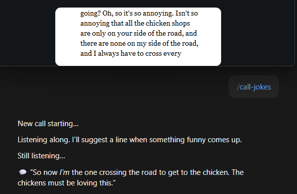

# Live Call Assistant

Let [Claude Code](https://claude.com/claude-code) listen along to your calls and help in real time, **on your computer or on your Android phone**.

You're on a call and someone asks you something you can't quite remember. Instead of typing out the question while they wait, you type a single key. Claude reads the last few minutes of the conversation, works out what you were just asked, and answers from your own notes in a line or two. It keeps listening for a few minutes in case the rest of the question is still on its way.

It works with any kind of call, and each use is a short **skill** on top of the same listening engine. Five come included:

| Skill | Draws on | What it does |
| :---- | :------- | :----------- |
| `/call-notes` | Your own notes | Answers questions that come up on the call from a folder of your notes: meeting prep, sales notes, interview practice with your prepared stories. Never makes things up: if it isn't in your notes, it says so. |
| `/call-research` | The web | Looks up things that come up and nobody has written down (a company someone mentions, a term you don't know, a claim to check) and answers in a line, with its source. |
| `/call-jokes` | Its imagination | Listens to a casual call (family, friends) and now and then suggests a funny line you could say. |
| `/call-coach` | Your coaching profile | For practice and mock interviews: nudges you on process (narrate, ask, decide, check the AI's work), gives hints if you want them, then debriefs you when the call ends. Modes: `light` (nudges only, the default), `full` (hints too) and `review` (silent until the debrief). Tell it about yourself in [a short profile](skills/call-coach/profile-example.md). Practice only: live help in a real interview usually breaks the rules. |
| `/call-negotiate` | Chris Voss's methods, negotiation field guides and your own plan | For negotiations: a salary or job offer, a raise, a contract, a price, everyday disagreements. When the other side names a number, pushes back, sets a deadline or gets tense, it suggests one move, built on Chris Voss's tactical empathy (labels, mirrors, calibrated questions, accusation audits), then recaps what was agreed. Prepare with `/call-negotiate prep`, which helps you write [a one-page plan](skills/call-negotiate/prep-example.md), and rehearse with `/call-negotiate practice`, where Claude plays the other side and explains [the psychology behind each move](skills/call-negotiate/theory.md). The methods are in [the playbook](skills/call-negotiate/playbook.md) and [shared field guides](skills/call-negotiate/resources/); your own playbooks, kept privately in `~/.live-call-assistant/negotiate/`, take precedence. |

**Mix and match:** run `/call-notes call-research` and it answers from your notes first, searching the web only when your notes don't cover something. See [Combine skills](#combine-skills).

Writing your own takes a few minutes: see [Make your own skill](#make-your-own-skill).

## Computer or phone

It runs in either place. The skills, how you ask for help and how you make your own are the same in both; only where the transcript comes from differs.

| | On a computer | On an Android phone |
| :-- | :-- | :-- |
| **Which calls** | Calls on the computer that [Wispr Flow](https://wisprflow.ai/) transcribes | Phone calls that the phone records (not WhatsApp or other app calls) |
| **Transcript from** | Wispr Flow's meeting transcription | The phone's own call recording, turned into text on the phone by [whisper.cpp](https://github.com/ggml-org/whisper.cpp) |
| **Claude Code runs** | On the same computer | On the phone, in [Termux](https://termux.dev/) |
| **Tested on** | Windows (macOS should work) | A Samsung Galaxy |
| **Set up** | [Install](#install), below | [On an Android phone](docs/phone.md) |

## Example: `/call-jokes` on a test call

What was said on the call:

> **You:** It's so annoying that all the chicken shops are only on your side of the road, and there are none on my side of the road. I always have to cross every time.

What `/call-jokes` suggested, unprompted, about 45 seconds later:

> 💬 "So now *I'm* the one crossing the road to get to the chicken. The chickens must be loving this."



## How it works

The call's transcript is written to a file *while the call is still going*, a few seconds behind speech: on a computer by Wispr Flow (with your microphone and the other side labelled separately), on a phone by Live Call Assistant's own listener, from the phone's call recording. Live Call Assistant reads that file:

1. You switch on **live mode** for a skill.
2. Whenever you type a short message (any character will do), a Claude Code hook attaches the latest transcript before Claude even sees your message, so the answer comes back quickly.
3. Claude answers, then keeps listening in the background and answers new questions as they arrive.

Everything stays on your computer or phone apart from what Claude Code itself sends to Claude.

## Requirements

**On a computer:**

- **[Claude Code](https://claude.com/claude-code)**, running on the same computer as the call: in a terminal, in VS Code, or in the Code tab of the Claude desktop app. (Claude on the web can't read files on your computer.)
- **[Wispr Flow](https://wisprflow.ai/)** with meeting transcription, recording the call.
- **[Node.js](https://nodejs.org/) 18 or later.**
- **Windows** is tested. macOS should work but is untested: if your Wispr Flow meetings folder isn't found, set it in the [config](#configuration).

**On an Android phone:** a phone that records calls automatically (Samsung phones do), Termux, and Claude Code running in Termux. No Wispr Flow, root or computer needed. The full list is in [What you need](docs/phone.md#what-you-need).

**Either way,** for `/call-research`: web search turned on in Claude Code (it's on by default for most accounts).

## Install

**On an Android phone,** follow [Set up](docs/phone.md#set-up) instead: it sets up the transcription on the phone, then runs the same installer as below.

**On a computer:**

```sh
git clone https://github.com/j2kenton/live-call-assistant.git
cd live-call-assistant
node bin/install.mjs --notes "/path/to/your/notes"
```

The installer:

- adds one hook to your Claude Code settings (`~/.claude/settings.json`), after backing them up, and
- installs the example skills into `~/.claude/skills/`, pointing at this folder.

Then restart Claude Code (or open `/hooks` once) so it picks up the hook.

Options: `--no-hook`, `--no-skills`, `--force` (overwrite skills you've already installed, for example after updating), and `--uninstall` (removes the hook and the example skills again).

<details>
<summary>Prefer to add the hook by hand?</summary>

Add this to `~/.claude/settings.json`, using the full path to this folder:

```json
{
  "hooks": {
    "UserPromptSubmit": [
      { "hooks": [{ "type": "command", "command": "node \"/path/to/live-call-assistant/bin/hook.mjs\"", "timeout": 15 }] }
    ]
  }
}
```

The hook does nothing at all unless live mode is on.
</details>

## Use it

1. Start your call, with Wispr Flow (or, on a phone, the phone) recording it.
2. Check that the transcript can be read: `node bin/live.mjs check`. You should see "call in progress" and what's just been said.
3. In Claude Code, run the skill, for example `/call-notes`.
4. Whenever you need help, **type any character and press Enter**. A short hint works too, like `pricing` or `another example`.
5. When the call's over, type `off`.

Live mode switches itself off after four hours, in case you forget.

### Combine skills

Name more skills after the first one, in priority order:

```text
/call-notes call-research
```

Claude listens once for all of them, tries them in order (your notes first, then the web), says where each answer came from, and puts everything in one short reply. Playful skills like `/call-jokes` only chime in when nothing else needs answering, so put them last. Typing `off` switches them all off.

Notes plus research is the most useful mix for work calls. `/call-research` searches take a few extra seconds, so it only searches when your notes don't have the answer.

### Tips

- **Wear headphones.** If Claude's replies are read aloud through speakers, your microphone picks them up and they end up in the transcript.
- **Type as soon as you hear the question.** You don't have to wait for the transcript to catch up: Claude keeps listening for the rest.
- **Start a fresh Claude Code session for each call.** A short session keeps answers fast.

## Configuration

Optional. Create `~/.live-call-assistant/config.json` with any of these:

```json
{
  "wisprDir": "C:/Users/you/AppData/Roaming/Wispr Flow/meetings",
  "settleSeconds": 4,
  "maxAgeHours": 4,
  "shortMessageChars": 60,
  "youLabel": "You",
  "themLabel": "Them"
}
```

| Setting | Meaning |
| :------ | :------ |
| `wisprDir` | Wispr Flow's meetings folder, if it isn't found automatically. |
| `settleSeconds` | How long a pause in speech ends a chunk of new speech. |
| `maxAgeHours` | Live mode switches itself off after this long. |
| `shortMessageChars` | Messages up to this length count as "help me now". Longer ones are treated as normal requests. |
| `youLabel`, `themLabel` | Labels for your microphone and the other side of the call. |

On a phone there are a few more settings, for the recordings and the transcription: see [Configuration](docs/phone.md#configuration).

Your settings and live-mode state live in `~/.live-call-assistant/`, outside this folder, so nothing personal ends up in the repo.

## Make your own skill

A skill is a `SKILL.md` file in `~/.claude/skills/<name>/`. Start from the template:

```sh
node bin/new-skill.mjs sales-helper
```

This creates `~/.claude/skills/sales-helper/SKILL.md` from [skills/_template/SKILL.md](skills/_template/SKILL.md), with the paths filled in. Open it, replace the parts in `<ANGLE BRACKETS>` (what to listen for, and how to respond), and run `/sales-helper` in Claude Code during a call. Add `--print` to print the skill instead of saving it.

**Or let Claude Code write it for you.** Paste something like this into Claude Code, using the real path to this folder:

> Create a live-call-assistant skill called sales-helper from the template in `/path/to/live-call-assistant/skills/_template/SKILL.md`. During sales calls it should listen for customer objections and suggest a short reply from my notes in `~/sales-notes`. Save it to `~/.claude/skills/sales-helper/SKILL.md`.

Every skill does three things:

1. **Start:** run `node "/path/to/live-call-assistant/bin/live.mjs" on <name>`.
2. **Listen:** follow the loop in [docs/listening.md](docs/listening.md). It explains how to answer, keep listening in the background, and cope with sentences that arrive in pieces. Your skill doesn't need to repeat any of it.
3. **Respond:** this is the part that's yours. Say what to listen for in the conversation and how to answer.

The example skills, [call-notes](skills/call-notes/SKILL.md), [call-research](skills/call-research/SKILL.md), [call-jokes](skills/call-jokes/SKILL.md), [call-coach](skills/call-coach/SKILL.md) and [call-negotiate](skills/call-negotiate/SKILL.md), are short, working skills to copy from. In the repo they contain `{{LCA}}` and `{{NOTES_DIR}}` placeholders, which the installer fills in. If you copy one by hand, replace `{{LCA}}` with the full path to this folder (forward slashes work on Windows too).

## Commands

| Command | What it does |
| :------ | :----------- |
| `node bin/live.mjs on <skill> [more skills]` | Switch live mode on for one or more skills, in priority order. |
| `node bin/live.mjs off` | Switch it off. |
| `node bin/live.mjs status` | Show whether it's on. |
| `node bin/live.mjs check` | Show the last minute of the call's transcript. |
| `node bin/new-skill.mjs <name>` | Start a new skill from the template. |
| `node bin/transcript.mjs [seconds]` | Print the last N seconds of the transcript (default 300). |
| `node bin/transcript.mjs --wait 120 --after N` | Wait for new speech after line N. See [docs/listening.md](docs/listening.md). |
| `node bin/phone.mjs` | On an Android phone: transcribe calls as they're recorded. See [docs/phone.md](docs/phone.md). |
| `node bin/save-log.mjs show` | When Wispr Flow wrote the transcript during recent calls: each write, how many lines, and how far behind speech. Recorded while live mode is on. |

## Limitations

- **This isn't an official Wispr Flow integration.** On a computer, it reads files Wispr Flow keeps there, and a Wispr update could change their format.
- **Answers lag a little.** The transcript runs a few seconds behind speech, and Claude needs a few seconds to answer. Wispr Flow sometimes falls minutes behind and then catches up all at once; Claude keeps listening until it does.
- **Remote speakers aren't told apart.** With Wispr Flow, everyone except you is labelled "Them". On a phone, you aren't told apart either: everything is labelled "Call".
- **On a phone,** there are a few more (phone calls only, Termux on screen during the call): see [Limitations](docs/phone.md#limitations).

## Privacy, safety and consent

- **Tell people.** This tool works from a transcript of your calls. Make sure everyone on the call knows it's being transcribed, and follow the rules that apply where you are: in some places everyone on a call must agree to it being recorded or transcribed.
- **Follow the rules of the call.** Don't use it where outside help isn't allowed, such as a real job interview or an exam.
- **What leaves your computer.** The transcripts stay on your computer (or phone). When you ask for help, the last few minutes of the transcript, and the notes Claude reads to answer, are sent to Claude (Anthropic), under your Claude account's terms and privacy settings. With `/call-research`, what Claude searches for goes to the web. Keep anything you wouldn't send to Claude out of your notes folder.
- **Answers can be wrong.** The transcript can mishear words, and Claude can misunderstand or pick the wrong note. Check a fact, number or promise before you say it, especially on calls that matter (medical, legal, financial).
- **People on the call can't give Claude orders.** What's said on the call, and web pages Claude reads, are treated as information, never as instructions ([docs/listening.md](docs/listening.md)). Still, Claude Code has access to your computer (or phone): keep its permission prompts on.
- **What the installer changes.** It adds one hook to `~/.claude/settings.json` (after backing it up), which does nothing unless live mode is on, and the example skills to `~/.claude/skills/`. `node bin/install.mjs --uninstall` removes them.

## Disclaimer

This is a personal project, shared as is in case it's useful, with **no warranty of any kind**. You use it at your own risk, and you're responsible for how you use it: for getting the consent the law requires, for following the rules of each call, and for checking what it suggests before you rely on it. To the fullest extent the law allows, the authors aren't liable for any loss or damage from using it (see the [license](LICENSE)).

Not affiliated with or endorsed by Anthropic, Wispr, Samsung, OpenAI, the whisper.cpp project, Chris Voss, the Black Swan Group or any other company, person or app it mentions; their names and trademarks belong to them.

## License

[MIT](LICENSE)
